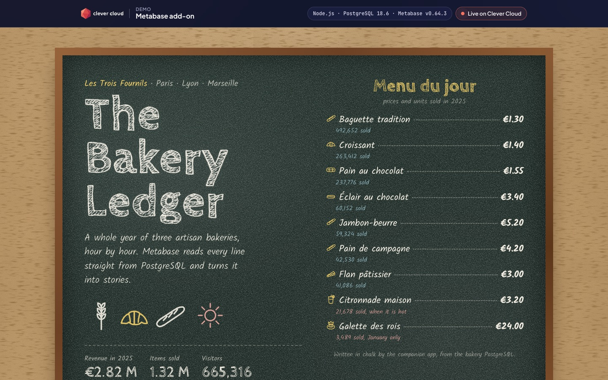
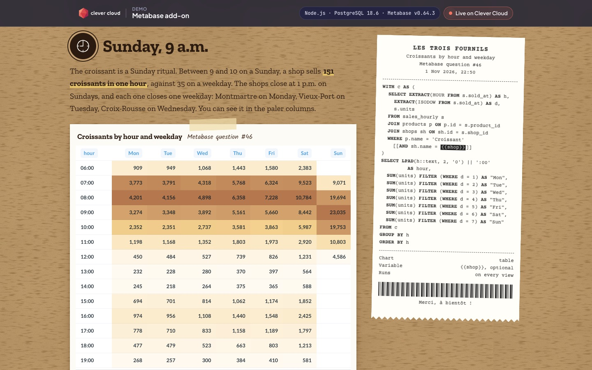
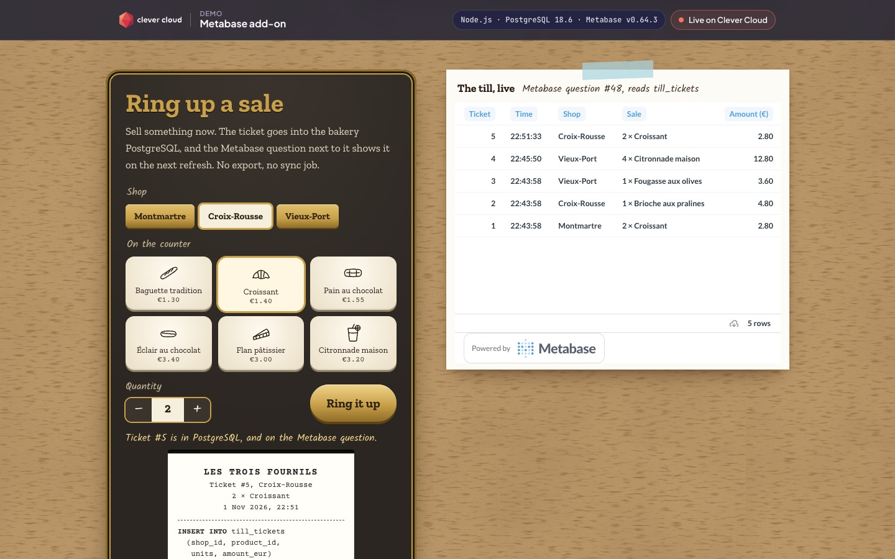
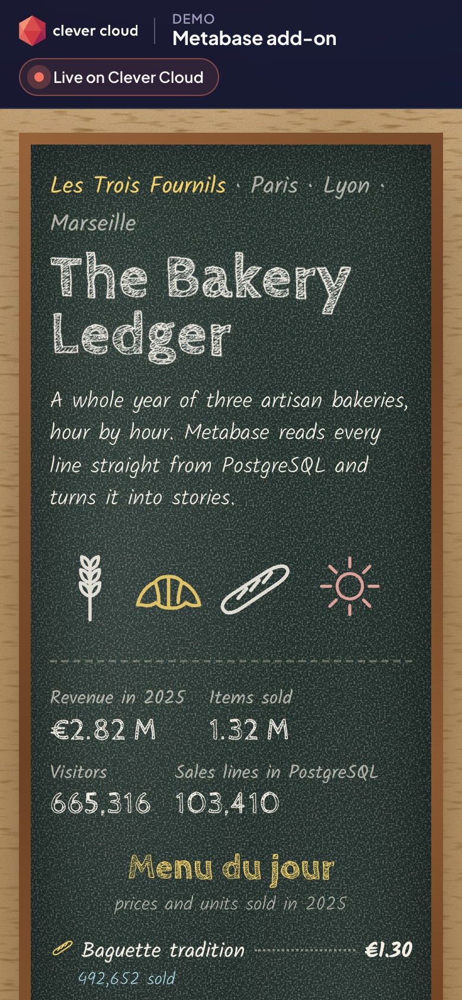

# The Bakery Ledger — Metabase on Clever Cloud

> A whole year in the life of **Les Trois Fournils**, three artisan bakeries in Paris, Lyon and Marseille, hour by hour. The sales live in a **PostgreSQL add-on**; the **Metabase add-on** turns them into stories: croissants peak on Sunday mornings, the galette des rois rules January, heat waves kill bread. A small companion page, drawn as a bakery chalkboard with kraft paper and till receipts, embeds the Metabase questions and prints the SQL behind each one. Everything in Metabase is created by API from this repo, so a fresh add-on is ready in one restart.



| Stories, with the SQL on a receipt | Ring up a sale, watch Metabase read it | On a phone |
|---|---|---|
|  |  |  |

**Run it yourself.** The hosted demo was taken down after the presales review (November 2026). The steps in [Deploy on Clever Cloud](#deploy-on-clever-cloud) recreate it from scratch in about 20 minutes, most of it waiting for the Metabase add-on to start.

**Get certified.** This demo runs on Clever Cloud. To deploy your own apps the same way, get certified at the [Clever Cloud Academy](https://academy.clever.cloud/).

---

## What each service does here

| Service | In the demo |
|---|---|
| **PostgreSQL add-on** (`xxs_sml`, encrypted at rest) | Holds the ledger: 103,410 hourly sales lines, footfall, daily weather per city, and the live till tickets. The companion app writes the year once at first boot (deterministic generator, idempotent). |
| **Metabase add-on** (plan `base`) | Managed BI: a Java app with Metabase pre-loaded and its own PostgreSQL for users, questions and dashboards, kept on the latest Community Edition by Clever Cloud. It connects to the bakery PostgreSQL and runs 9 native SQL questions and one dashboard. |
| **Node.js app** (the companion page) | Provisions Metabase through its REST API at every boot, signs the static-embedding tokens (HS256), writes the chalkboard menu and the shop tags from PostgreSQL, and runs the till. |

What you see Metabase doing on the page:

- **Four stories**, each one a saved Metabase question embedded with a signed token, next to a till receipt printing the exact SQL it runs on every view.
- **The till**: ring up a sale, the ticket is `INSERT`ed into PostgreSQL, and the embedded Metabase question shows it on the next refresh. No export, no sync job.
- **The whole ledger**: the dashboard, with shop tabs. Each tab asks the server for a new token with the shop *locked* inside, the pattern for embedding one dashboard for many customers.
- **Behind the counter**: the list of Metabase API calls made at boot (wizard or login, embedding, data source, questions, dashboard), with status codes and timings.

---

## Deploy on Clever Cloud

You need [clever-tools](https://www.clever.cloud/developers/doc/cli/) (`clever login` done), `openssl`, and the ID of the organisation that will own the resources (`orga_…`, shown in the Console). Run the commands from the repo root: `clever create` links the folder to the new app.

```bash
# 1. The app and its size
clever create --type node demo-metabase --region par --org <org_id>
clever scale --min-flavor nano --max-flavor XS --min-instances 1 --max-instances 2
clever scale --build-flavor M

# 2. The bakery PostgreSQL (xxs_sml, encrypted at rest), linked to the app
clever addon create postgresql-addon demo-metabase-pg --plan xxs_sml --option encryption=true --region par --org <org_id>
clever service link-addon demo-metabase-pg

# 3. Metabase (plan base; no encryption option offered). Not linked: it exposes no variable.
clever addon create metabase demo-metabase-bi --plan base --region par --org <org_id>
#    note the "Access it" URL it prints: https://<id>-metabase.services.clever-cloud.com

# 4. Variables
clever env set METABASE_SITE_URL https://<id>-metabase.services.clever-cloud.com
sh scripts/set-secrets.sh   # random admin password + independent embedding secret, set with clever env set, never printed
clever env set NODE_ENV production
clever env set CC_HEALTH_CHECK_PATH /health
# optional: clever env set METABASE_ADMIN_EMAIL <you@example.com>   (default baker@les-trois-fournils.example)

# 5. Deploy
clever deploy
clever open
```

`scripts/set-secrets.sh` is the only setup script; run it once, before the first deploy. It generates `METABASE_ADMIN_PASSWORD` with `openssl rand -hex 24` and `METABASE_EMBEDDING_SECRET_KEY` with `openssl rand -hex 32`, and stores both on the app without printing them.

At boot the app writes the ledger, then completes Metabase's first-run wizard with the admin account (or logs in on later boots), enables static embedding, connects the bakery database and creates the collection, the questions and the dashboard. The page waits and reloads itself while the add-on starts. Check that `https://<your-app>.cleverapps.io/health/deep` returns 200.

**Signing in to Metabase itself** (optional, the page works without it):

1. Open the `METABASE_SITE_URL` above.
2. Sign in with `baker@les-trois-fournils.example` (or your `METABASE_ADMIN_EMAIL`).
3. The password is the app's `METABASE_ADMIN_PASSWORD`: Console, application `demo-metabase`, *Environment variables*. Nobody has to complete the Metabase setup wizard: the app already did.

Demo sizing: `nano` to `XS`, 1 to 2 instances, dedicated `M` build.

### Variables

| Variable | Set by | Role |
|---|---|---|
| `POSTGRESQL_ADDON_URI` | PostgreSQL add-on (linked) | Bakery database, read by the app and passed to Metabase as its data source |
| `METABASE_SITE_URL` | you | The Metabase add-on URL ("Access it"); the add-on exposes no variable to link |
| `METABASE_ADMIN_PASSWORD` | `scripts/set-secrets.sh` | Password of the Metabase admin created by the setup script (random, `openssl rand -hex 24`, 48 hex chars; the app refuses fewer than 16) |
| `METABASE_EMBEDDING_SECRET_KEY` | `scripts/set-secrets.sh` | Static embedding secret, its own random value (`openssl rand -hex 32`, 64 hex chars, mandatory). The app writes it into Metabase (`embedding-secret-key`) and signs the iframe tokens with it. It is never derived from the password: tokens are public, so anything they could reveal must be worthless |
| `METABASE_ADMIN_EMAIL` | you, optional | Admin e-mail, default `baker@les-trois-fournils.example` |
| `NODE_ENV` | you | `production`, as the Node.js runtime doc asks |
| `CC_HEALTH_CHECK_PATH` | you | `/health` |

The "Running on Clever Cloud" panel shows `CC_APP_NAME`, `APP_ID`, `INSTANCE_NUMBER`, `INSTANCE_TYPE`, `CC_PRETTY_INSTANCE_NAME`, `CC_COMMIT_ID` and `CC_DEPLOYMENT_ID`, nothing else.

### Recreate before a meeting

The Metabase add-on costs about €37 per 30 days, so it is deleted between meetings; the bakery PostgreSQL can stay.

1. `clever addon create metabase demo-metabase-bi --plan base --region par --org <org_id>` and note the "Access it" URL.
2. `clever env set METABASE_SITE_URL <that URL>`
3. `clever restart`: the app provisions the new Metabase with the admin password and embedding secret already set on the app (about 30 API calls, a few seconds once Metabase answers; the page waits and reloads itself while the add-on starts).
4. Check `https://<your-app>.cleverapps.io/health/deep` returns 200, then open the page.

To run the provisioning by hand instead: `npm run metabase:setup` with the same variables in `.env`.

---

## Routes

| Route | Role |
|---|---|
| `GET /` | The page; its data is embedded as JSON, no extra round trip |
| `GET /health` | 200 without touching any add-on |
| `GET /health/deep` | PostgreSQL query + Metabase `/api/health`; 503 if either fails |
| `GET /api/ledger` | Everything the page shows, as JSON |
| `GET /api/embed?shop=Montmartre` · `?question=till_live` | A freshly signed embed URL and its payload |
| `GET /api/till` · `POST /api/till` | Last tickets · ring up a sale (`{shop, product, units}`, 1 to 12 units, 20 per minute per address, 500 tickets kept) |

---

## Local development

```bash
cp .env.example .env        # a local PostgreSQL, and a Metabase (brew install metabase, or Docker)
npm install
npm run dev                 # http://localhost:8522
npm test                    # node:test; the database test runs when POSTGRESQL_ADDON_URI is set
```

Node.js 24 (pinned in `package.json`), one dependency: `pg`.

## Project structure

```
server.js              → HTTP routes, CSP, boot (seed, then Metabase provisioning in the background)
src/dataset.js         → the year 2025: shops, products, weather, seasonality (seeded, deterministic)
src/db.js              → schema, idempotent seed with unnest(), chalkboard facts, the till
src/questions.js       → every Metabase question: SQL, chart settings, dashboard layout
src/metabase.js        → Metabase REST API provisioning, recorded call by call
scripts/set-secrets.sh → generates the two Metabase secrets and sets them on the app, silently
src/embed.js           → static embedding: HS256 JWT in ten lines
scripts/metabase-setup.js → the same provisioning, one shot, from a terminal
public/                → the page (index.html, app.css, app.js) and the Clever Brand Kit files
test/                  → dataset story, embedding, SQL receipts, routes and the till round trip
```

The data is generated: Les Trois Fournils, its shops and its numbers are fictional. Every drawing is hand-written SVG; fonts come from Google Fonts.

MIT License, see [LICENSE](LICENSE). Source: [github.com/Vitiosum/demo-metabase](https://github.com/Vitiosum/demo-metabase).
